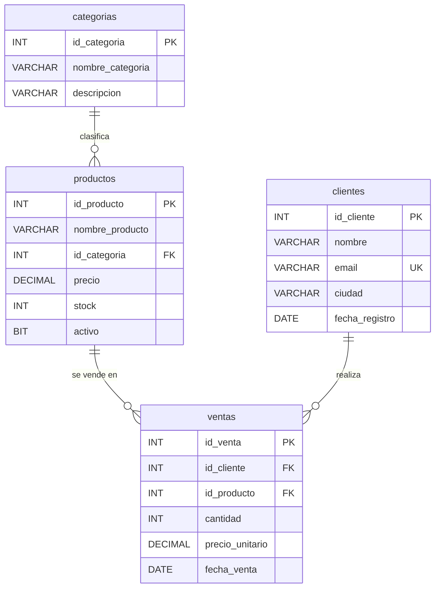

# RetailPro

> Proyecto integrador del curso de **Data Analytics (Coderhouse)**: análisis de ventas de una distribuidora de tecnología, construido módulo a módulo, desde la base de datos hasta el dashboard.

## Contenido

1. [Descripción del proyecto](#descripción-del-proyecto)
2. [Herramientas utilizadas](#herramientas-utilizadas)
3. [Estructura del repositorio](#estructura-del-repositorio)
4. [Modelo de datos](#modelo-de-datos)
5. [Cómo ejecutar los scripts SQL](#cómo-ejecutar-los-scripts-sql)
6. [Qué responde cada consulta](#qué-responde-cada-consulta)
7. [Notas para continuar el proyecto](#notas-para-continuar-el-proyecto)
8. [Sobre el uso de IA en este README](#sobre-el-uso-de-ia-en-este-readme)

---

## Descripción del proyecto

**RetailPro** es un caso de negocio sobre una distribuidora de tecnología (en los scripts y en Power BI la empresa figura como **TechStore**): laptops, monitores, periféricos, audio y almacenamiento. El objetivo es responder preguntas comerciales a partir de sus datos de ventas: cuánto se factura por mes, qué productos generan más ingresos, qué clientes son recurrentes y qué clientes o productos no tienen movimiento.

El proyecto se construye con una entrega por módulo del curso, y cada módulo agrega una capa sobre el anterior:

| Módulo | Tema | Dónde está |
|--------|------|------------|
| M3 | Ingeniería de datos: creación y carga de la base `Ventas_Tech_DB` (checkpoint) | `ventas_tech_db.sql` |
| M4 | Consultas SQL de negocio (agregaciones, ranking, `HAVING`, subconsultas) | `m4_ventas_adicionales.sql`, `m4_consultas_negocio.sql` |
| M5 | Consultas con `JOIN` (`INNER`, `LEFT`) y `UNION ALL` | `m5_consultas_joins.sql` |
| M6 | Pipeline ETL en Power BI (Power Query / M): limpieza de 4 tablas a partir de `Pipeline_ETL_Dataset.xlsx` | `m6-pipeline-etl/` |
| M8 | Modelo en Power BI: 4 relaciones 1:N activas, tabla calendario `Dim_Fechas` y 5 medidas core en DAX | `m8-modelo-dax/` |
| M9 | Uso de IA para documentar y optimizar el análisis: este README salió de una versión generada con IA y corregida a mano | `README.md`, `m9-ia-documentacion/` |

Los módulos siguientes, hasta el dashboard final, se irán sumando al repositorio.

> **Ojo con el origen de los datos:** la parte SQL (M3 a M5) trabaja con `Ventas_Tech_DB` (20 ventas). Power BI (M6 y M8) **no lee de SQL Server**: parte de `Pipeline_ETL_Dataset.xlsx`, un dataset del curso con más registros (50 ventas en `Fact_Ventas`). Son dos conjuntos de datos distintos. La Consulta 1 de M5 se pensó como tabla base para Power BI, pero en M6 y M8 el modelo se armó con el Excel.

> **Importante:** los scripts SQL dependen unos de otros y hay que ejecutarlos en un orden fijo. Ver [Cómo ejecutar los scripts SQL](#cómo-ejecutar-los-scripts-sql).

---

## Herramientas utilizadas

| Herramienta | Uso en el proyecto |
|-------------|--------------------|
| **Microsoft SQL Server 2022 (T-SQL)** | Motor de la base de datos `Ventas_Tech_DB`, corriendo en un contenedor **Docker** (imagen oficial de Microsoft) |
| **Docker Desktop** | Levanta el contenedor `sql-coderhouse` con SQL Server, en una Mac |
| **DBeaver** | Cliente donde probé los scripts (en Mac) |
| **SQL Server Management Studio (SSMS)** | Los scripts están diseñados para que también corran en SSMS |
| **Excel** | Fuente de datos de M6 y M8 (`Pipeline_ETL_Dataset.xlsx`, provisto por el curso) |
| **Power BI Desktop + Power Query (M)** | Pipeline ETL (M6) y modelo con medidas DAX (M8), archivos `.pbix` |
| **DAX** | Medidas del modelo en Power BI |
| **Git y GitHub** | Control de versiones y entrega del proyecto |

---

## Estructura del repositorio

```text
.
├── README.md
├── ventas_tech_db.sql
├── m4_ventas_adicionales.sql
├── m4_consultas_negocio.sql
├── m5_consultas_joins.sql
├── m6-pipeline-etl/
├── m8-modelo-dax/
└── m9-ia-documentacion/
```

| Archivo / carpeta | Qué hace |
|-------------------|----------|
| `README.md` | Este documento. |
| `ventas_tech_db.sql` | **Punto de partida (M3).** Crea la base `Ventas_Tech_DB` si no existe, borra y recrea las 4 tablas, define claves primarias y foráneas, y carga los datos iniciales (4 categorías, 6 clientes, 7 productos y 10 ventas). Termina con consultas de validación. |
| `m4_ventas_adicionales.sql` | Agrega las ventas 11 a 20 (abril a junio de 2024), porque las 10 ventas originales caían todas en marzo y las consultas por mes devolvían una sola fila. Usa clientes y productos ya existentes, por lo que no rompe ninguna clave foránea. Se puede ejecutar más de una vez: si la venta 11 ya existe, no hace nada. |
| `m4_consultas_negocio.sql` | 4 consultas de negocio sobre `ventas`: resumen mensual, ranking de productos, clientes recurrentes y meses por encima o por debajo del promedio. Incluye notas de diseño y hallazgos. |
| `m5_consultas_joins.sql` | 4 consultas con `JOIN`: vista base ventas + clientes + productos + categorías, clientes sin ventas, productos sin ventas y consolidado con `UNION ALL`. |
| `m6-pipeline-etl/` | Trabajo de M6: pipeline ETL en Power Query con 4 consultas limpias (`Dim_Clientes`, `Dim_Productos`, `Dim_Categorias`, `Fact_Ventas`), archivos `.pbix`, capturas del perfilado y un README propio con las decisiones de limpieza. Ver [`m6-pipeline-etl/README.md`](m6-pipeline-etl/README.md). |
| `m8-modelo-dax/` | Trabajo de M8: modelo con 4 relaciones 1:N activas, `Dim_Fechas` y tabla `_Medidas` con 5 medidas core en DAX. Archivo `.pbix` y un README corto. Ver [`m8-modelo-dax/README.md`](m8-modelo-dax/README.md). |
| `m9-ia-documentacion/` | Trabajo de M9 (uso de IA): la versión original de este README tal como la generó la IA, sin modificar, y la lista de cambios que le hice con la justificación de cada uno. Ver [`m9-ia-documentacion/README.md`](m9-ia-documentacion/README.md). |

---

## Modelo de datos

La base `Ventas_Tech_DB` tiene cuatro tablas. Una categoría tiene muchos productos, un cliente tiene muchas ventas y cada venta corresponde a un único producto y a un único cliente.



### Detalle de las tablas

**`categorias`**

| Columna | Tipo | Restricciones |
|---------|------|---------------|
| `id_categoria` | `INT` | PK |
| `nombre_categoria` | `VARCHAR(50)` | `NOT NULL` |
| `descripcion` | `VARCHAR(200)` | admite `NULL` |

**`clientes`**

| Columna | Tipo | Restricciones |
|---------|------|---------------|
| `id_cliente` | `INT` | PK |
| `nombre` | `VARCHAR(100)` | `NOT NULL` |
| `email` | `VARCHAR(100)` | `UNIQUE`, admite `NULL` |
| `ciudad` | `VARCHAR(50)` | admite `NULL` |
| `fecha_registro` | `DATE` | `NOT NULL` |

**`productos`**

| Columna | Tipo | Restricciones |
|---------|------|---------------|
| `id_producto` | `INT` | PK |
| `nombre_producto` | `VARCHAR(100)` | `NOT NULL` |
| `id_categoria` | `INT` | FK → `categorias.id_categoria` |
| `precio` | `DECIMAL(10,2)` | `NOT NULL` |
| `stock` | `INT` | `NOT NULL`, por defecto `0` |
| `activo` | `BIT` | `NOT NULL`, por defecto `1` |

**`ventas`**

| Columna | Tipo | Restricciones |
|---------|------|---------------|
| `id_venta` | `INT` | PK |
| `id_cliente` | `INT` | FK → `clientes.id_cliente` |
| `id_producto` | `INT` | FK → `productos.id_producto` |
| `cantidad` | `INT` | `NOT NULL` |
| `precio_unitario` | `DECIMAL(10,2)` | `NOT NULL` |
| `fecha_venta` | `DATE` | `NOT NULL` |

Los precios usan `DECIMAL` y no `FLOAT` para evitar errores de redondeo con importes.

### Datos cargados

| Tabla | Filas | Comentario |
|-------|-------|------------|
| `categorias` | 4 | Computación, Accesorios, Audio, Almacenamiento |
| `clientes` | 6 | El cliente 6 (Sofia Medina, registrada el 2024-02-10) **no tiene ventas a propósito** |
| `productos` | 7 | El producto 7 (Webcam HD Pro, activa, precio 85, stock 10) **no tiene ventas a propósito** |
| `ventas` | 10 tras el M3, **20** tras `m4_ventas_adicionales.sql` | Rango de fechas: marzo a junio de 2024 |

Son datos de ejemplo con fines didácticos, cargados a mano. El cliente 6 y el producto 7 existen solo para poder mostrar en M5 el patrón `LEFT JOIN ... IS NULL` con un caso real; no son errores de carga.

---

## Cómo ejecutar los scripts SQL

### Requisitos

- Una instancia de **SQL Server** accesible. En este proyecto es SQL Server 2022 en Docker: contenedor `sql-coderhouse`, puerto `1401`, usuario `sa`. La contraseña no está en el repositorio (es público). Si reinicio la Mac o cierro Docker Desktop, el contenedor se detiene: hay que abrir Docker Desktop y arrancarlo antes de conectar DBeaver.
- Un usuario con permiso para crear bases de datos: el primer script crea `Ventas_Tech_DB` si no existe.
- Un cliente SQL: **DBeaver** (donde se probaron los scripts), **SSMS** o `sqlcmd`.

### Orden de ejecución

| Paso | Script | Qué produce |
|------|--------|-------------|
| 1 | `ventas_tech_db.sql` | Base, tablas y datos iniciales (4 / 6 / 7 / 10 filas) |
| 2 | `m4_ventas_adicionales.sql` | Ventas 11 a 20 (total: 20 ventas) |
| 3 | `m4_consultas_negocio.sql` | 4 consultas de negocio (solo lectura) |
| 4 | `m5_consultas_joins.sql` | 4 consultas con JOINs (solo lectura) |

### Paso a paso

1. **Clonar el repositorio**

   ```bash
   git clone https://github.com/cgonzalez201012/ventas-tech-db.git
   cd ventas-tech-db
   ```

2. **Conectarse a SQL Server** desde el cliente elegido. No hace falta que `Ventas_Tech_DB` exista todavía.

3. **Ejecutar `ventas_tech_db.sql` completo.**
   - En DBeaver: abrir el archivo y usar *Execute SQL Script* (`Option + X` en Mac, `Alt + X` en Windows). `Cmd + Enter` en Mac (`Ctrl + Enter` en Windows) ejecuta solo la sentencia actual y no sirve para este caso.
   - Antes de ejecutar, revisar que el editor tenga una conexión asignada (selector arriba, junto a los íconos de ejecutar). Si dice `N/A`, DBeaver responde *No active connection*: elegir la conexión ahí, o abrir un script nuevo con la conexión seleccionada y pegar el contenido del archivo.
   - En SSMS: abrir el archivo y presionar `F5` sin nada seleccionado.

   El archivo usa `GO` para separar lotes, así que hay que correrlo entero y no por partes.

   Verificación: la última consulta del script debe devolver `total_categorias = 4`, `total_clientes = 6`, `total_productos = 7` y `total_ventas = 10`.

4. **Ejecutar `m4_ventas_adicionales.sql`.**

   Verificación: el `SELECT COUNT(*)` final debe devolver `total_ventas = 20`.

5. **Ejecutar `m4_consultas_negocio.sql`.** Cada `SELECT` devuelve su propio conjunto de resultados.

6. **Ejecutar `m5_consultas_joins.sql`.**

**Alternativa por línea de comandos** (no la probé así desde fuera del contenedor; en M3 corrí `ventas_tech_db.sql` con `sqlcmd` desde dentro del contenedor, sin errores). El servidor es un contenedor Linux con usuario `sa`, por eso no sirve la autenticación de Windows (`-E`). Si da error de certificado, agregar `-C`:

```bash
sqlcmd -S localhost,1401 -U sa -P "<tu_contraseña>" -i ventas_tech_db.sql
sqlcmd -S localhost,1401 -U sa -P "<tu_contraseña>" -i m4_ventas_adicionales.sql
sqlcmd -S localhost,1401 -U sa -P "<tu_contraseña>" -i m4_consultas_negocio.sql
sqlcmd -S localhost,1401 -U sa -P "<tu_contraseña>" -i m5_consultas_joins.sql
```

### Cuidados al re-ejecutar

- **`ventas_tech_db.sql` es destructivo para las tablas:** borra y recrea `ventas`, `productos`, `clientes` y `categorias` (la base en sí no se borra). Si se vuelve a correr, se pierden las ventas 11 a 20, y hay que repetir el paso 2.
- `m4_ventas_adicionales.sql` es seguro de repetir: si la venta 11 ya existe, no inserta nada.
- Los scripts de consultas (`m4_consultas_negocio.sql` y `m5_consultas_joins.sql`) solo leen datos y se pueden correr las veces que haga falta.
- Las consultas de M4 y M5 deben correrse **después** del paso 2. Con solo las 10 ventas originales los resultados no coinciden con los hallazgos documentados en los scripts.

### Resultados esperados (para validar el entorno)

**M4, Consulta 1: resumen mensual** (el ticket promedio puede mostrarse con más decimales)

| mes | total_facturado | cantidad_pedidos | ticket_promedio |
|-----|-----------------|------------------|-----------------|
| 3 | 6444.00 | 10 | 644.40 |
| 4 | 1952.00 | 4 | 488.00 |
| 5 | 2590.00 | 4 | 647.50 |
| 6 | 425.00 | 2 | 212.50 |

- **M4, Consulta 2:** el Top 5 por facturación es, en orden, los productos 1, 3, 6, 4 y 2 (el producto 5 queda fuera del Top 5).
- **M4, Consulta 3:** los 5 clientes con ventas aparecen con 4 pedidos cada uno.
- **M4, Consulta 4:** solo marzo figura como "Por encima" del promedio mensual (2852.75).
- **M5, Consulta 1:** devuelve 20 filas, una por venta.
- **M5, Consulta 2:** devuelve a Sofia Medina.
- **M5, Consulta 3:** devuelve a Webcam HD Pro.
- **M5, Consulta 4:** "Primer periodo" = 8396 y "Segundo periodo" = 3015.

---

## Qué responde cada consulta

### M4 — `m4_consultas_negocio.sql`

| # | Pregunta de negocio | Técnica |
|---|---------------------|---------|
| 1 | ¿Cuánto se facturó por mes, cuántos pedidos hubo y cuál fue el ticket promedio? | `GROUP BY` con `DATEPART(MONTH, ...)` |
| 2 | ¿Cuáles son los 5 productos que más facturan, y cuántas unidades vendieron? | `TOP 5` + `ORDER BY` |
| 3 | ¿Qué clientes compraron más de una vez y cuánto gastaron? | `GROUP BY` + `HAVING` |
| 4 | ¿Qué meses superan el promedio mensual de facturación? | Subconsultas + `CASE` |

### M5 — `m5_consultas_joins.sql`

| # | Pregunta de negocio | Técnica |
|---|---------------------|---------|
| 1 | Vista base: quién compró, qué compró, de qué categoría, desde qué ciudad y por cuánto | 3 `INNER JOIN` encadenados |
| 2 | ¿Qué clientes están registrados pero nunca compraron? | `LEFT JOIN` + `IS NULL` |
| 3 | ¿Qué productos del catálogo nunca se vendieron? | `LEFT JOIN` + `IS NULL` |
| 4 | Total de ventas por período (antes y desde el 1 de mayo de 2024) | `UNION ALL` + `GROUP BY` |

La Consulta 1 de M5 se pensó como tabla base para Power BI, pero Power BI (M6 y M8) se armó con el dataset Excel del curso, no con esta consulta.

---

## Notas para continuar el proyecto

- **Una fila de `ventas` es una línea con un único producto.** No hay una tabla de cabecera y detalle de pedidos: en las consultas de M4, "pedido" significa "fila de `ventas`".
- **Los meses se agrupan por número, sin año.** M4 usa `DATEPART(MONTH, fecha_venta)`, que es válido mientras todos los datos sean de 2024. Si se cargan ventas de otros años, hay que agrupar también por año.
- **`DATEPART` en lugar de `EXTRACT`.** La consigna del módulo sugería `EXTRACT(MONTH FROM ...)`, que es sintaxis de PostgreSQL y no existe en SQL Server. Se usa `DATEPART`, su equivalente en T-SQL.
- **El "canal" de la Consulta 4 de M5 es ficticio.** La base no tiene una columna de canal ni de sucursal; el script lo simula con dos períodos de tiempo (antes y desde el 1 de mayo de 2024) para practicar `UNION ALL`.
- **La muestra es chica y tiene huecos que no son de negocio.** Con 20 ventas en 4 meses, marzo concentra el 56 % de la facturación porque las 10 ventas originales (carga de M3) caen todas entre el 5 y el 15 de marzo; las otras 10 se agregaron después, repartidas en abril, mayo y junio.
- **Junio es un mes parcial.** La última venta cargada es del 14/06/2024, así que sus 2 ventas ($425) no son un mes completo: la baja de junio no se debe leer como una caída de ventas. Entre abril y junio el ritmo es parecido (4, 4 y 2 ventas en 30, 31 y 14 días).
- **Cada uno de los 5 clientes con ventas tiene exactamente 4 ventas, en 4 fechas distintas.** Es un patrón de la carga de ejemplo, no un comportamiento real de compra: no sirve para medir frecuencia de clientes.
- **Antes de modificar el esquema o los datos**, revisar el impacto en los módulos posteriores, que se construyen sobre esta base. Recordar además que `ventas_tech_db.sql` recrea las tablas desde cero.

---

## Sobre el uso de IA en este README

Este README forma parte de la **Entrega 9 (M9)**, sobre el uso de IA para documentar y optimizar el análisis. Partió de una versión generada con IA (Claude) a partir de los 4 scripts SQL. La revisé contra el repositorio real y la corregí: atajos de teclado de Mac, conexión real a SQL Server en Docker (la versión de la IA proponía autenticación de Windows y el puerto por defecto), el origen de los datos de Power BI (Excel, no SQL Server), la descripción de M6 y M8 y los límites de los datos. Las cifras de referencia las contrasté con los resultados que me devolvió DBeaver.

La versión original de la IA y el detalle de cada cambio están en [`m9-ia-documentacion/`](m9-ia-documentacion/README.md).
